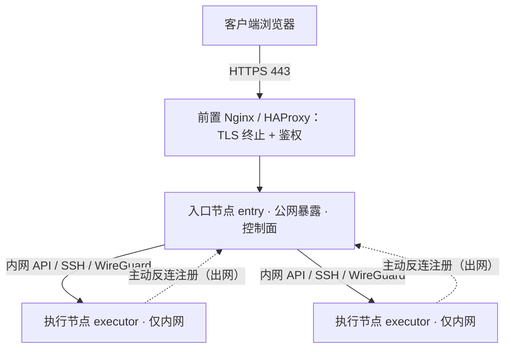

# 多服务器入口拓扑：单入口控制面 + 内网执行节点

本文落地部署口径：客户端从哪里进、执行节点放在哪、公网直连多台时有哪些可选方案、
动态 IP 怎么反连、节点端口怎么收口，以及这些口径在本仓库契约里落到了哪些字段。
运维页只展示节点归属与健康，不暴露节点真实内网地址。

## 1. 基础约束

- 一个公网 IP 的同一个端口，报文只能落到一台机器：`IP:port` 是唯一转发目标，
  不存在「同一 IP 同一端口同时后端多台」的裸转发。
- 多节点部署不需要多公网 IP：执行节点留在私网，只有控制面入口需要公网可达。
- 有状态控制台（登录会话、草稿、在途工单状态挂在会话与租约上）不许做无粘滞的
  轮询负载均衡；同一客户端必须落到同一台入口，见 §4。

## 2. 标准拓扑：单入口控制面 + 内网执行节点

推荐形态，也是默认契约口径：

- **入口节点（`role: entry`，`public_exposed: true`）**：唯一对公网暴露的机器，
  承担 HTTPS 接入、TLS 终止、登录鉴权与反向代理；客户端只连这一台。
- **执行节点（`role: executor`，`public_exposed: false`）**：放在私网/内网，
  不分配公网地址、不对公网监听。控制面经内网 API、SSH 隧道或 WireGuard 隧道
  向执行节点调度；执行节点的产物与状态回流控制面台账。
- **前端口径**：运维页只读节点归属（入口/执行）、暴露面与健康度；节点真实内网
  IP、端口、套接字路径不下发，视图只给脱敏地址 `endpoint_masked`。

### 拓扑图（ASCII）

```
                         公网
  客户端浏览器 ──────────────────────────┐
                                         │ HTTPS 443（TLS 终止 + 鉴权）
                                         ▼
                              ┌────────────────────┐
                              │  入口节点 entry      │  public_exposed=true
                              │  控制面 / 反向代理  │  对公网唯一暴露
                              └─────────┬──────────┘
                   内网 API / SSH 隧道 / WireGuard
              ┌───────────────┼───────────────┐
              ▼               ▼               ▼
      ┌──────────────┐ ┌──────────────┐ ┌──────────────┐
      │ 执行节点 exec │ │ 执行节点 exec │ │ 执行节点 exec │  仅内网
      │ public=false │ │ public=false │ │ public=false │
      └──────────────┘ └──────────────┘ └──────────────┘
        执行节点主动反连入口注册（出网即可，入口不必反向连入）
```

### 拓扑图（mermaid）



## 3. 执行节点从哪来、怎么连

| 通道 | 方向 | 适用 | 口径 |
| --- | --- | --- | --- |
| 内网 API（同私网） | 入口 → 执行 | 节点同在一个 VPC / 局域网 | 执行节点端口只对入口内网地址放行 |
| SSH 隧道 | 入口 → 执行（经 SSH 转发） | 没有二层互通、仅能跳板 | 按节点建转发通道，用完即收 |
| WireGuard 隧道 | 入口 ↔ 执行（组网） | 跨机房 / 跨网段加密互通 | 隧道地址静态，节点端口绑定隧道网卡 |
| 节点主动反连 | 执行 → 入口 | 执行在 NAT 后、无入站路由 | 出网建连，入口不主动拨入执行节点 |

调度面（分配、租约、fencing、迁移台账）归控制面；执行节点不直接互访，也不向
客户端暴露自己的地址。

## 4. 必须公网直连多台时的三种方案

只有在确实需要多台机器对公网提供服务时才用；标准形态不必走到这一步。

### 方案 A：每台独立公网 IP

- 每台机器绑一个独立公网 IP，DNS 按记录拆分；每台各自终止 TLS。
- 最简单、无共享入口状态；缺点是 IP 成本高，入口扩机器就要加 IP。

### 方案 B：同 IP 不同端口 DNAT

- 同一个公网 IP 上，用端口区分后端：`公网 IP:8443 → 机器1:8787`，
  `公网 IP:8444 → 机器2:8787`。
- **端口约束**：`80` / `443` 只能给其中一台；其余服务必须用高位端口，或由前置
  代理按域名/路径转发（方案 C）。
- 客户端配置要带端口；证书一般按域名签发，端口本身不隔离域名。

### 方案 C：前置 Nginx / HAProxy 按域名或路径转发

- 前置代理终止 TLS，按 `server_name`（域名）或 `location`（路径）把报文转到
  不同后端入口。
- **会话粘滞是硬要求**：控制台有登录会话与在途状态，同一客户端必须固定到同一台
  入口后端；禁止不配粘滞就做纯轮询。
  - 开源 Nginx：用 `hash $cookie.<会话cookie> consistent;` 按会话Cookie粘滞，
    取不到 Cookie 时退回 `ip_hash;`；Nginx Plus 可用 `sticky cookie`。
  - HAProxy：`cookie <name> insert indirect nocache`，后端带 `cookie` 标记。
- 按域名分流时，不同域名可以指向不同后端；按路径分流时要确认前后端路由前缀
  不冲突，SSE / WebSocket Upgrade 头必须透传。

| 方案 | 公网 IP | 粘滞要求 | 适用 |
| --- | --- | --- | --- |
| A 独立 IP | 每台一个 | 不涉及（每台独立） | 后端少、可接受 IP 成本 |
| B 端口 DNAT | 共用一个 | 不涉及（端口即固定后端） | 临时暴露、内部使用 |
| C 前置代理分流 | 共用一个 | **必须会话粘滞，不做轮询** | 多入口域名/路径分流 |

## 5. 动态 IP 与 NAT 后节点

节点没有固定公网地址时，由节点主动把通道建回控制面，入口不依赖能拨入节点：

- **DDNS + 端口映射**：路由器/网关把端口映射到内网节点，DDNS 跟踪动态公网 IP；
  适合家庭/办公网入口，端口映射表要随节点变更同步。
- **frp**：执行/入口节点在 NAT 后时，连到有公网地址的 frps，由 frp 反代回内网；
  节点侧只做出站连接。
- **Cloudflare Tunnel**：节点跑 cloudflared 主动连 Cloudflare 边缘，不开入站端口；
  域名解析到隧道，TLS 在边缘终止。隧道地址与凭证按 profile 隔离，不进前端。

## 6. 节点注册方向与白名单

- **优先方向：节点主动连云控面**。执行节点只做出站连接即可注册、心跳、领租约；
  控制面反连执行节点只作为内网备选（同私网或隧道已打通时）。
- **端口白名单**：执行节点监听端口默认只放行控制面入口的出口 IP（或内网网段 /
  隧道地址），不对 0.0.0.0 开放；注册上报的地址只用于控制面调度，不下发前端。
- 入口节点自身的公网入站只开放代理端口（80/443），管理端口（SSH 等）限制来源
  网段或走堡垒机。

## 7. Nginx 最小配置示例

前置代理终止 TLS、反代到入口节点，并透传会话与 Upgrade 头；单后端时粘滞指令
不生效也无害，多入口后端时按 §4-C 保持会话粘滞。

```nginx
# 上游入口：单后端直接写一台；多入口必须按会话粘滞，不做纯轮询
upstream ai_new_entry {
    # 开源 Nginx：按会话 Cookie 粘滞，取不到 Cookie 退回按源地址哈希
    hash $cookie.hive_token consistent;
    server 10.0.0.11:8787;
    # server 10.0.0.12:8787;   # 第二台入口：会话仍粘在首次落到的那台
}

server {
    listen 80;
    server_name ai.example.com;
    return 301 https://$host$request_uri;
}

server {
    listen 443 ssl;
    server_name ai.example.com;

    ssl_certificate     /etc/nginx/tls/fullchain.pem;
    ssl_certificate_key /etc/nginx/tls/privkey.pem;
    ssl_protocols       TLSv1.2 TLSv1.3;

    location / {
        proxy_pass http://ai_new_entry;
        proxy_http_version 1.1;

        # 透传原始协议与客户端信息，后端鉴权/日志才能拿到真实来源
        proxy_set_header Host              $host;
        proxy_set_header X-Real-IP         $remote_addr;
        proxy_set_header X-Forwarded-For   $proxy_add_x_forwarded_for;
        proxy_set_header X-Forwarded-Proto $scheme;

        # SSE / WebSocket：Upgrade 头必须透传，长连接才不断
        proxy_set_header Upgrade           $http_upgrade;
        proxy_set_header Connection         $connection_upgrade;
        proxy_read_timeout 300s;
        proxy_buffering off;
    }
}
```

> `$connection_upgrade` 映射在 `nginx.conf` 的 `map` 段定义：
> `map $http_upgrade $connection_upgrade { default upgrade; '' close; }`。

## 8. 与仓库契约的对应

| 拓扑口径 | 契约落点 |
| --- | --- |
| 入口 / 执行归属 | 节点行 `role`：`entry` / `executor`，缺省 `executor` |
| 是否对公网暴露 | 节点行 `public_exposed`：执行节点 `false`（仅内网），入口 `true` |
| 不下发真实内网地址 | 只读视图剔除原始 `endpoint`，只给 `endpoint_masked`（协议保留，主机/端口打码） |
| 注册方向 | 节点主动注册上报 `nodes.register`；入口反连为内网备选 |
| 默认口令拦截 | `server.auth.enabled` 开启后若仍是默认账号/口令或摘要为空，启动打显著告警，控制台顶部横幅提示改密；生产必须改默认口令 |

相关代码与契约：

- 节点归属与脱敏：`ai_new/modules/agent/nodes/private/_pure.py`、
  `ai_new/modules/agent/nodes/data/api.yaml`
- 鉴权与默认口令告警：`ai_new/modules/agent/auth/__init__.py`、
  `ai_new/modules/agent_common/config/data/config.default.yaml`
- 运维页展示：`ai_new/modules/agent/web/data/console/`（节点类型 / 脱敏地址 / 暴露面 / 云端通道只读区块）

## 9. 未验证项

- 跨机房 WireGuard 组网与 frp / Cloudflare Tunnel 反连通道在本轮只落口径与契约，
  未在多台真机上联调；上线前需按 §5 选一条通道做端到端注册与心跳验证。
- 多入口会话粘滞在开源 Nginx 上按 Cookie / ip_hash 配置；真实会话 Cookie 名以
  控制台登录下发为准，换 Cookie 名要同步更新 §7 的 `hash` 键。
