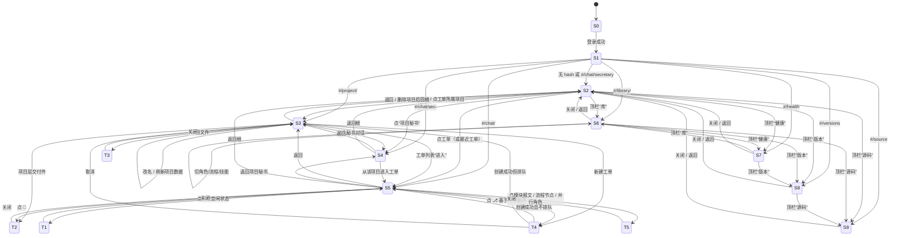

# Hive Agent 前端状态机（v4.1）

本文把网页的页面、覆盖层、弹窗、侧栏和登录态全部收进一张状态机。它既是设计文档，也是发版前的验收清单：每条转移都在 `web/app.js` 里有对应入口，受影响的页面必须在 PC 与安卓上各走一遍。

## 1. 状态定义

| 编号 | 状态 | 页面/组件 | 路由（hash） | 说明 |
|---|---|---|---|---|
| S0 | 未登录 | 登录面板 | 无（任意 hash 都先登录） | 只显示密码框；登录成功进入 S2 |
| S1 | 载入 | 空壳 | 当前 hash | 拉 `/api/web/groups`、`/api/idle/status`，期间不响应导航 |
| S2 | 全局秘书 | `#chatview` | `#/chat/secretary` | 根页面；返回按钮隐藏；可切项目/覆盖层 |
| S3 | 项目页 | `#projectview` | `#/project/<pid>` | 管理项目：改名、工单、秘书、新建工单、文件、交付件 |
| S4 | 项目秘书 | `#chatview` | `#/chat/sec-<pid>` | 项目级对话；上下文只属于该项目 |
| S5 | 工单群聊 | `#chatview` | `#/chat/<T-id>` | 角色发言 + 模块报文折叠 + 生命周期流程条；结单后只读 |
| S6 | 能力库 | `#modal` | `#/library/<roles\|flows\|skills>` | 覆盖层；角色/流程/技能/标签库 |
| S7 | 健康自检 | `#modal` | `#/health` | 覆盖层；检查项、交付件体积、压缩入口 |
| S8 | 版本管理 | `#modal` | `#/versions` | 覆盖层；git 提交列表与回退 |
| S9 | 源码浏览 | `#modal` | `#/source` | 覆盖层；agent 源码/配置只读 |
| T1 | 空闲队列弹窗 | `#modal`（不占路由） | 当前路由不变 | 由顶栏“空闲/高峰”打开 |
| T2 | 交付件侧栏 | `#side` | 当前路由不变 | 由 📎 打开；工单层/项目层/公共层 |
| T3 | 项目文件弹窗 | `#modal`（不占路由） | 当前路由不变 | 项目 main 工作树只读 |
| T4 | 新建/派生工单弹窗 | `#modal`（不占路由） | 当前路由不变 | 侧栏 ⎇ 或项目页表单 |
| T5 | 模块报文/流程节点详情 | `#modal`（不占路由） | 当前路由不变 | 点模块消息、流程节点、并行角色 |

约束：S6–S9 是“覆盖层”，会替换 hash 并进入历史栈；T1–T5 是“临时弹窗”，不进入历史栈。这样浏览器返回键永远只回退“页面”，不会在同一个页面的多个弹窗之间迷路。

## 2. 状态转移图

## 3. 返回键（浏览器返回 / 顶栏 ← / Esc）优先级

`goBack()` 按固定优先级处理，保证安卓物理返回与 PC 顶栏返回行为一致：

1. 有弹窗（T1–T5）：关闭弹窗；如果当前是覆盖层 hash（S6–S9），走 `history.back()`。
2. 交付件侧栏打开：关闭侧栏。
3. 移动端抽屉打开：关闭抽屉。
4. `navDepth > 0`：`history.back()`（正常回退到上一个页面）。
5. 深链进入且没有历史栈：
   - 工单群聊 → 该项目页（`replaceState`，不新增历史）；
   - 项目页 → 全局秘书；
   - 项目秘书 → 全局秘书；
   - 全局秘书 → 提示“已经是最外层”。

Esc 与顶栏 ← 完全复用这套逻辑；`popstate` 只做“按 hash 恢复页面”，不会再次 push，避免历史栈原地增长。

## 4. 路由与刷新

| 场景 | 行为 |
|---|---|
| 刷新 `#/project/p3a` | 登录态有效 → 直接回到 P3A 项目页 |
| 刷新 `#/chat/T-...` | 回到该工单群聊；工单已删则提示并回根 |
| 刷新 `#/health` | 先渲染全局秘书作为底层，再打开健康覆盖层 |
| 分享链接 | 直接把 hash 发给别人即可定位项目/工单/库 |
| 登录过期（401） | 清 token、回 S0；重新登录后按当前 hash 恢复 |

## 5. 关键业务状态（不是页面，但会改变可用性）

| 业务状态 | UI 表现 | 可用操作 |
|---|---|---|
| `queued` | 工单列表状态 chip 为 queued；顶栏显示“排队 N” | 可进只读详情；可“立即执行队列” |
| `running` / `planning` | 流程条高亮当前节点；角色分支显示 running | 可发言、可打断、可看实时流 |
| `conflict` | 流程条出现“冲突处理”；工单可继续对话 | PM 必须解决冲突 → `ticket_verify` → 再结单 |
| `closing` | 流程条“验收结单”高亮 | 等待归档/合并；不重复结单 |
| `closed` | 输入框禁用、只读提示、`＋tag` 隐藏 | 只能看历史/交付件；要改就 ⎇ 新开 |
| 空闲/高峰 | 顶栏 pill 绿/黄 | 高峰新工单默认排队，可勾“立即执行” |
| 服务重启 | 页面短时失联 | watchdog 拉起后刷新即恢复；工单由 PM 续跑 |

## 6. 验收清单（PC + 安卓各一遍）

- [ ] 登录 → 根页面，顶栏 ← 隐藏。
- [ ] 点项目 → 项目页；浏览器返回 → 根页面；顶栏 ← 同效。
- [ ] 项目页进工单 → 群聊；返回 → 项目页；再返回 → 根页面。
- [ ] 刷新工单页 → 仍在同一工单；刷新项目页 → 仍在同一项目。
- [ ] 打开库/健康/版本/源码 → 关闭或返回 → 回到进入前的页面。
- [ ] 工单群打开交付件侧栏 → 返回键先关侧栏，不退出工单。
- [ ] 移动端打开抽屉 → 返回键先关抽屉。
- [ ] 结单工单：输入框禁用、只读提示、无 `＋tag`；点 ⎇ 可派生新工单。
- [ ] 深链 `#/chat/<不存在的工单>` → 提示并回根，不白屏。

## 7. 已知边界

- 交付件侧栏与临时弹窗**不进入浏览器历史**：这是有意设计，避免返回键在弹窗层级里打转；侧栏用自身 ✕ 或返回键关闭。
- 覆盖层之间用顶栏直接切换时是 `replaceState`，不会为每次切换新增历史；只有“从页面进入覆盖层”才 push。
- 页面轮询（5s 时间线 / 900ms 流式）只更新内容，不触发路由，不会打断用户当前滚动位置。
